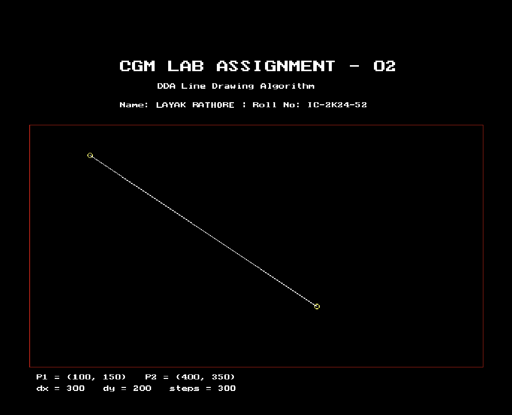

# CGM Lab Assignment 02: DDA Line Drawing Algorithm

**Student Name:** Layak Rathore  
**Roll Number:** IC-2K24-52  
**Lab Assignment:** 02  
**Subject:** Computer Graphics & Multimedia (CGM)

---

## 🎯 Objective

To study the mathematical principles of raster scan conversion and implement the **Digital Differential Analyzer (DDA)** Line Drawing Algorithm in **C++** using the `graphics.h` library. The program takes interactive user coordinates, validates boundaries, calculates incremental step values, and renders the line pixel-by-pixel using `putpixel()`.

---

## 📚 Mathematical Theory & Concepts Learned

### 1. What is Scan Conversion?
In computer graphics, a line segment is geometrically continuous and defined by its endpoint coordinates $(x_1, y_1)$ and $(x_2, y_2)$. However, display monitors consist of a discrete matrix of pixels. **Scan conversion** (or rasterization) is the process of digitizing a continuous line into discrete pixel coordinates $(x, y)$ that best approximate the ideal mathematical line.

### 2. Mathematical Foundation of DDA
The standard equation of a straight line in slope-intercept form is:
$$y = m \cdot x + c$$

Where the slope $m$ is given by:
$$m = \frac{\Delta y}{\Delta x} = \frac{y_2 - y_1}{x_2 - x_1} = \frac{dy}{dx}$$

Directly evaluating $y = m \cdot x + c$ at each point requires floating-point multiplication, which is computationally expensive. The DDA algorithm solves this using a **differential formulation**:
$$\Delta y = m \cdot \Delta x \quad \text{and} \quad \Delta x = \frac{\Delta y}{m}$$

### 3. Step Determination & Slope Cases
To prevent gaps or disconnected lines, the step size must be driven by whichever axis undergoes the greater change:

| Slope Condition | Driving Axis | Number of Steps | Increments ($\Delta x, \Delta y$) | Characteristics |
| :--- | :--- | :--- | :--- | :--- |
| **$|m| \le 1$ ($|dx| \ge |dy|$)** | $X$-axis | $steps = |dx|$ | $\Delta x = \pm 1$, $\Delta y = \frac{dy}{|dx|} = \pm m$ | Shallow line; sampled at unit $X$ intervals |
| **$|m| > 1$ ($|dy| > |dx|$)** | $Y$-axis | $steps = |dy|$ | $\Delta x = \frac{dx}{|dy|} = \pm \frac{1}{m}$, $\Delta y = \pm 1$ | Steep line; sampled at unit $Y$ intervals |

### 4. Unified Generalized Formula
By taking:
$$steps = \max(|dx|, |dy|)$$
The incremental additions along each axis become:
$$\Delta x = \frac{dx}{steps}, \qquad \Delta y = \frac{dy}{steps}$$

This elegant generalization automatically handles:
- All 8 octants of the coordinate plane
- Lines drawn left-to-right or right-to-left
- Horizontal lines ($dy = 0$) and vertical lines ($dx = 0$)
- Degenerate single-point inputs ($steps = 0$)

### 5. Floating-Point Rounding Strategy
Because pixels lie on an integer grid, each computed coordinate $(x, y)$ must be rounded to the nearest integer pixel center:
$$\text{round}(v) = \lfloor v + 0.5 \rfloor$$
Using simple integer truncation (`(int)v`) leads to asymmetric directional bias and jagged lines; `roundOff(v)` ensures accurate nearest-neighbor pixel mapping.

### 6. Pros & Cons of the DDA Algorithm

- **Advantages:**
  - Simple, intuitive, and easy to implement.
  - Eliminates multiplication inside the inner loop by replacing it with incremental additions.
  - Faster than direct calculation via $y = mx + c$.
- **Limitations:**
  - Requires floating-point arithmetic and rounding operations at every pixel step.
  - Accumulation of rounding errors over long lines can cause slight drift from the true geometric line.
  - Slower compared to integer-only algorithms like **Bresenham's Line Algorithm**.

---

## 🛠️ What I Did (Implementation Details)

1. **Modular Architecture:**
   - Created a dedicated rounding utility:
     ```cpp
     int roundOff(float v) {
         return (int)floor(v + 0.5f);
     }
     ```
   - Encapsulated the algorithm into a clean, reusable function: `ddaLine(int x1, int y1, int x2, int y2, int color)`.

2. **Interactive Console Input & Coordinate Validation:**
   - Prompted the user via standard input for starting $(x_1, y_1)$ and ending $(x_2, y_2)$ coordinates.
   - Enforced strict canvas boundary validation:
     $$20 \le x_1, x_2 \le 620 \quad \text{and} \quad 110 \le y_1, y_2 \le 430$$
   - Prevented out-of-bounds rendering or program crashes if invalid coordinates are supplied.

3. **Console Telemetry & Diagnostics:**
   - Computed and printed diagnostic metrics to the terminal before entering graphics mode:
     - $dx$, $dy$, and total $steps$
     - $x\_increment$ and $y\_increment$ (to 3 decimal places)

4. **Rich Graphical User Interface (GUI):**
   - **Header Banner:** Displays the assignment name, topic, student name, and roll number.
   - **Drawing Canvas:** Rendered a high-contrast boundary box in **RED** defining the active workspace $(20, 110)$ to $(620, 430)$.
   - **Pixel-by-Pixel Line Rendering:** Plotted the calculated trajectory in **WHITE** using `putpixel()`.
   - **Endpoint Markers:** Highlighted the exact starting and ending points with small **YELLOW** circles (`circle(x, y, 3)`) for visual clarity and verification.
   - **Live HUD / Telemetry Overlay:** Formatted and rendered real-time metrics at the bottom of the screen:
     - `P1 = (x1, y1)   P2 = (x2, y2)`
     - `dx = ...   dy = ...   steps = ...`

---

## 💻 Source Code Overview

The complete implementation is available in [`dda_line.cpp`](./dda_line.cpp).

### Core DDA Implementation:
```cpp
void ddaLine(int x1, int y1, int x2, int y2, int color)
{
    int dx = x2 - x1;
    int dy = y2 - y1;

    // Calculate number of steps based on driving axis
    int steps = (abs(dx) > abs(dy)) ? abs(dx) : abs(dy);

    // Handle single-point degenerate case
    if (steps == 0)
    {
        putpixel(x1, y1, color);
        return;
    }

    // Incremental step calculations
    float xInc = (float)dx / steps;
    float yInc = (float)dy / steps;

    float x = (float)x1;
    float y = (float)y1;

    // Incremental rasterization loop
    for (int i = 0; i <= steps; i++)
    {
        putpixel(roundOff(x), roundOff(y), color);
        x += xInc;
        y += yInc;
    }
}
```

---

## 🖼️ Program Output

Below is the graphical output generated after entering valid endpoints:



---

## 🚀 How to Compile & Run

### Using MinGW / GCC (Windows):
```bash
# Compile
g++ dda_line.cpp -o dda_line.exe -lbgi -lgdi32 -lcomdlg32 -luuid -loleaut32 -lole32

# Run
./dda_line.exe
```

### Interactive Execution Flow:
1. When prompted in the terminal:
   ```text
   === DDA Line Drawing Algorithm ===
   Drawing area: x = 20 to 620, y = 110 to 430

   Enter starting point (x1 y1): 50 150
   Enter ending point (x2 y2): 500 380
   ```
2. The terminal displays calculated steps and increment values:
   ```text
   dx = 450, dy = 230, steps = 450
   x_increment = 1.000, y_increment = 0.511
   ```
3. The graphics window opens, rendering the boundary, line, endpoint markers, and HUD summary.
4. Press any key in the graphics window to return and exit.

---

## 💡 Key Takeaways
- Understood the concept and necessity of rasterization in digital displays.
- Implemented incremental computation to avoid costly continuous multiplication inside rendering loops.
- Mastered user input validation, coordinate safety, and graphical telemetry display in C++.
